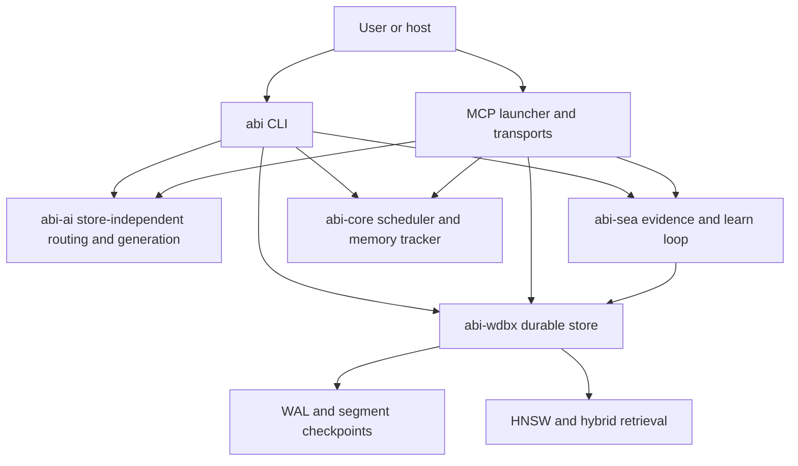

ABI uses Rust edition 2024 with workspace `rust-version = "1.99"` in
`Cargo.toml`; `rust-toolchain.toml` pins exact stable `1.99.1`. The package
minimum and pinned toolchain are distinct contracts. This specification does
not establish testing on Rust 1.99.0; exact-tree stable qualification is recorded
separately in the completion matrix. Invoke Cargo through `./tools/cargo.sh`.

ABI is a stable-Rust workspace. The agent layer is a local control plane for
deterministic routing, template generation, optional provider calls, and
evidence-aware completion. WDBX is the local memory plane for vectors,
key/value metadata, linked blocks, temporal and spatial records, snapshots,
WAL recovery, and bounded search.

<Note type="warning">
  Source wins. When this page disagrees with `Cargo.toml`, `crates/`,
  `tests/golden/`, or `./tools/check.sh`, trust the executable source and
  tests. Public claims remain governed by
  [External Claims Audit](../contracts/external-claims-audit).
</Note>

## Runtime map



`abi-ai` has no WDBX dependency: application wrappers and `abi-sea` own store
access. The map shows completion and evidence paths. The training registry and
the library foundations below are available for explicit host composition;
they do not add public commands.
Launch MCP through `./mcp/launcher.sh stdio` so binary selection and the macOS
FoundationModels shim resolve together.

Both binaries are local-first. MCP uses JSON-RPC over stdio and automatically
attempts a custom loopback HTTP listener that serves persistent MCP 2024-11-05
HTTP+SSE sessions and a one-shot direct-reply `/message` compatibility mode; it
is not Streamable HTTP (2025-03-26). WDBX REST and cluster RPC have their own explicit bind, token, and
claim boundaries.

## Ownership

| Layer | Source | Responsibility |
| --- | --- | --- |
| CLI | `crates/abi-cli/` | Frozen command dispatch, one-shot diagnostics, local completion, and WDBX operations |
| MCP | `crates/abi-mcp/` | Frozen tool dispatch, stdio JSON-RPC, and a best-effort custom loopback HTTP compatibility listener |
| AI | `crates/abi-ai/` | Profiles, deterministic routing, local templates, lexical constitution signal, model catalog, orchestration records |
| SEA | `crates/abi-sea/` | Query planning, evidence scoring/selection, bounded prompt augmentation, adaptive-router persistence |
| Agent contracts | `crates/abi-agent-runtime/` | Provider-neutral requests/events, tool descriptions, policy/audit, usage, budgets and cooperative cancellation; no inference, tool execution or persistence |
| Agent host | `crates/abi-agent-host/` | Startup-owned schemas, validation before policy, audited execution through a supplied executor, correlated continuation and bounded runs |
| Model registry | `crates/abi-models/` | Pinned manifests, publisher trust, principal-bound license consent, bounded hash-verified external artifact delivery; no inference |
| Model execution | `crates/abi-model-runtime/` | Explicit authorized manifest/device selection and Candle provider; tiny `abi-bigram-v1` fixture architecture |
| Worker control | `crates/abi-worker/` | Signed jobs/cancellation, leases, replay control, bounded results and independent job-control storage; no listener, scheduler or model executor |
| Capability kernel | `crates/abi-capability/` | Deny-by-default request-scoped authorization, bounded fallible digest audit and local recording actuator; no production actuator |
| Core | `../wdbx/crates/abi-core/` | One-process scheduler, task accounting, registry, and memory tracking |
| WDBX | `../wdbx/crates/abi-wdbx/` | In-process storage, HNSW search, recovery, records, reference crypto/compression, local RPC demos |
| Connectors | `crates/abi-connectors/` | Explicit live/local provider transports and credential boundaries |

## Completion and evidence flow

The ordinary local path is:

1. `abi-ai` resolves an explicit leading profile selector or applies the
   deterministic keyword router.
2. The selected Abbey, Aviva, or ABI template formats the input locally.
3. The constitution module emits a bounded lexical policy signal. It is not a
   general safety classifier or proof that content is safe.
4. When a store is configured, the CLI attempts to persist query and response
   vectors, metadata, and a linked block.

`abi complete --learn` adds the SEA path:

1. `QueryPlan` classifies the local retrieval task.
2. `gather_evidence_with_plan` scores and selects bounded evidence from WDBX.
3. `augment_prompt` prepends the selected context within its byte budget.
4. The local completion runs. When adaptation is enabled, router state is
   updated only after a passing audit without a veto; rejected completions
   do not become learned completion evidence.

No credentials are required for either local path. Live Anthropic,
FoundationModels, and local OpenAI-compatible bridge paths cross separate
connector boundaries and must disclose the transport that actually generated
the output.

## WDBX storage path

`VersionedStore` is the writable product boundary. New stores use v2; a first
write to v1 performs verified migration and retains a byte-exact backup, while
read-only v1 inspection remains non-mutating. V2 writers publish independent
causal journals and immutable snapshots without a shared writer-session lock.
`DurableStore` remains the v1 compatibility reader/migration fixture. The
versioned product surface supports:

- key/value records and completion metadata;
- vectors with exact and HNSW-style cosine search;
- SHA-256-linked blocks and verification;
- temporal, causal, persona, and spatial ranking components;
- bounded multiway rewriting experiments;
- compaction and checkpoint retention.

Tests must use `ABI_WDBX_PATH=:memory:`, `ABI_WDBX_PERSIST=0`, or a
counter-based scratch path. They must never open the operator's live
`~/.abi/` store.

## Scheduler and orchestration boundary

`abi-core::Scheduler` is a one-process task runner. It does not provide
durable jobs, remote workers, or multi-host execution.

The custom worker API in `abi-ai::orchestration` currently produces local
deterministic worker reports. Worker instructions and tool hints are metadata;
they do not execute tools. Any compatibility mode that prints scheduler task
IDs drains those tasks before the CLI exits and must not be described as a
durable background-agent system.

## Agent, model and worker foundations

These are Current library boundaries supported by source and contract fixtures:

- `abi-agent-host` composes a `ModelProvider`, startup-owned tool registry,
  execution policy, audit sink and `ToolExecutor`. It validates JSON arguments
  before authorization and audits decisions before allowed execution. Duplicate
  calls, fabricated tool results and post-terminal events fail closed.
  Cancellation, deadlines and budgets are cooperative; an active synchronous
  adapter must poll to stop before returning.
- `abi-models` verifies signed publisher manifests and artifact hashes, binds
  consent to the principal and exact revision, and publishes external downloads
  without clobbering an existing destination. Unsigned loaders remain explicit
  local/test-provenance APIs. Weights, datasets and adapters stay outside source.
- `abi-model-runtime` connects that authorization to explicit Candle devices.
  Generated scratch fixtures exercise Tokenizers/Safetensors CPU inference and
  locally tested Metal operations. Requested, initialized and executed device
  evidence are distinct. The only implemented architecture is `abi-bigram-v1`;
  Gemma and structured model-generated tool calls remain Proposed. CUDA has no
  local compile/runtime proof without an available toolchain and hardware.
- `abi-worker` verifies audience-bound Ed25519 jobs and cancellation requests,
  derives principal-scoped retry identity, and bounds leases, quotas and result
  streams. Its mandatory-mTLS configuration reuses the gateway loader. This
  does not establish an active worker listener, remote execution, deployed
  certificate lifecycle or production separate-host cluster. WDBX data-plane
  membership grants no worker job-control authority.
- `abi-capability` authorizes local recording adapters with request-scoped
  principals, grants and approvals. Its recording actuator is fixture evidence,
  not proof of a production filesystem, shell or network actuator.

Evidence entry points are `crates/abi-agent-runtime/tests/contracts.rs`,
`crates/abi-agent-host/tests/contracts.rs`,
`crates/abi-model-runtime/tests/contracts.rs`,
`crates/abi-worker/tests/contracts.rs`, `crates/abi-capability/tests/kernel.rs`
and the corresponding crate sources.
They establish bounded local behavior, not blanket safety or model quality.

## Approved training foundation

`abi-ai::training_contracts` owns store-independent approved-record admission,
source/permission/approval bindings, deterministic snapshot identity and run/
artifact receipts. Its Abbey, Aviva, Abi and Quesar training profile values do
not expand the ordinary three-profile completion router.

`abi-sea::training_registry` owns the private WDBX-backed registry, configured
principal authority, evidence/qualification bindings, revocation, eligibility,
immutable snapshots and export. Callers authenticate principals before entering
privileged APIs; registered evidence remains a trusted attestation boundary.
Split isolation spans retained immutable history, and training export refuses
held-out snapshots. `training_artifacts` publishes bounded content-addressed
artifacts under the owned private registry root; this trusts the same user
against concurrent filesystem replacement.

`crates/abi-sea/tests/training_foundation.rs` explicitly exercises synthetic
fixtures across all four profiles. Together with training contract, registry
and artifact tests, this supports source-level admission, recovery/refusal and
receipt behavior. It does not prove actual trained weights, tensor changes,
independent model quality, licensed training permission, teacher/student
optimization or serving cutover. Those remain separate evidence requirements.

## Security and deployment boundary

- The automatically attempted custom MCP loopback HTTP compatibility listener
  and WDBX REST are loopback-oriented. MCP `/sse` sessions are persistent
  2024-11-05 HTTP+SSE, capped at 16, not Streamable HTTP. Bearer tokens are local hardening,
  not complete authorization or TLS.
- Cluster RPC is real TCP RequestVote/AppendEntries with optional token and
  peer allowlist controls. Production multi-host deployment and sharding are
  not proven.
- Compression and homomorphic-encryption surfaces are reference
  implementations unless a stronger audited artifact is explicitly cited.
- Metal acceleration is reported only when linked kernels initialize;
  CUDA/Vulkan/ANE execution is not implied by capability detection.

See [WDBX North-Star](./wdbx-north-star),
[Cluster mTLS Ops](./cluster-mtls-ops), and
[Non-loopback REST Threat Review](./non-loopback-rest-threat-review).

## Contracts and verification

The exact frozen command and MCP tool names live in
[Public API Contract](../contracts/public-api). Do not duplicate those lists in
architecture prose.

```bash
./tools/check.sh
.agents/skills/run-abi/smoke.sh
.agents/skills/sea-learn-loop/learn.sh
.agents/skills/wdbx-bench/bench.sh 50
```

When they pass, these commands provide local evidence for build, tests,
contract behavior, and representative runtime paths. They do not prove
public-internet hardening, distributed operation, model quality, or production
performance.
